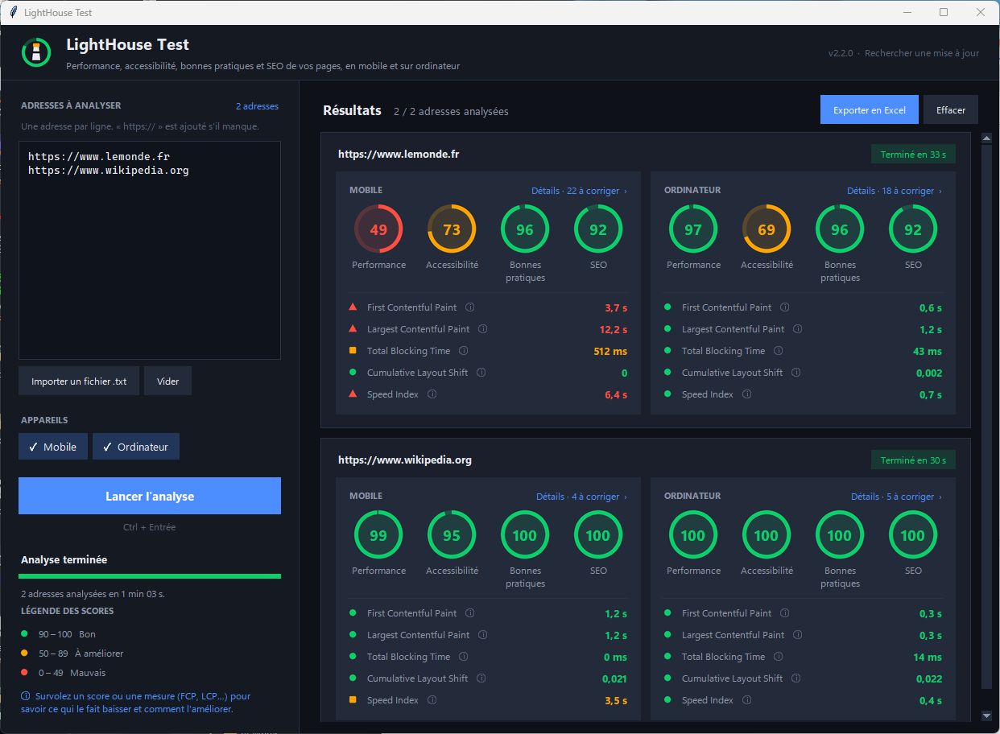
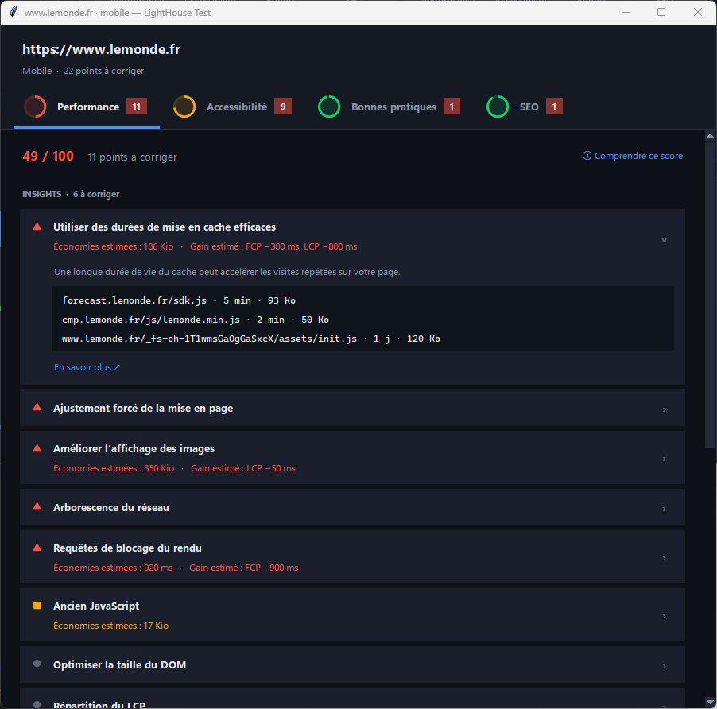
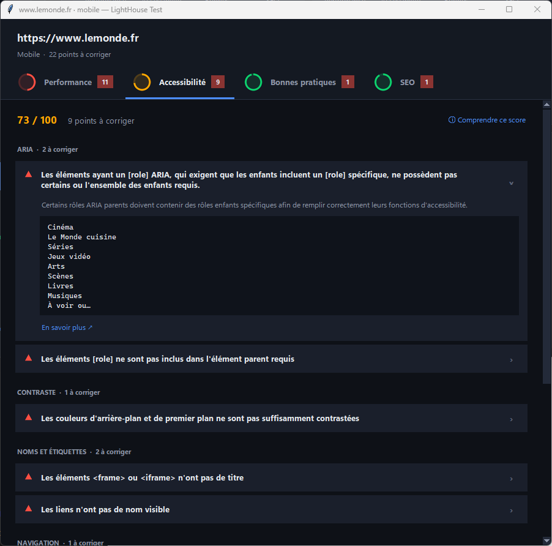
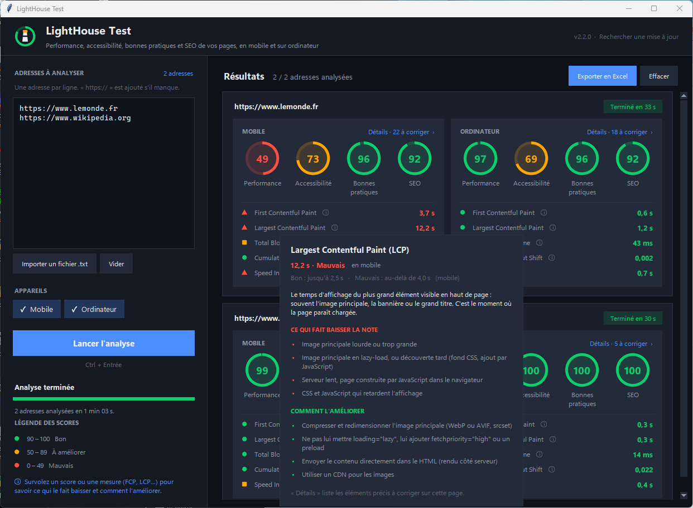

# LightHouse Test

**LightHouse Test** mesure la qualité de vos pages web avec [Lighthouse](https://developer.chrome.com/docs/lighthouse) (l'outil de Google utilisé par PageSpeed Insights). Il analyse une ou plusieurs adresses en **mobile** et sur **ordinateur**, affiche les scores et les mesures clés avec un code couleur, détaille **chaque point à corriger** (Insights, Diagnostic…) avec des conseils, et exporte le tout dans un classeur **Excel**.

## Fonctionnalités

- **Plusieurs adresses d'un coup** : collez-les (une par ligne) ou importez un fichier `.txt`. `https://` est ajouté s'il manque, les doublons sont ignorés.
- **Mobile et ordinateur**, au choix ou les deux.
- **4 scores sur 100** pour chaque page : Performance, Accessibilité, Bonnes pratiques, SEO.
- **5 mesures de vitesse** : First Contentful Paint (FCP), Largest Contentful Paint (LCP), Total Blocking Time (TBT), Cumulative Layout Shift (CLS) et Speed Index, colorées selon les seuils de chaque appareil.
- **Détails de chaque analyse**, comme dans Lighthouse : sections **Insights** et **Diagnostic** pour la performance, et tous les points à corriger en accessibilité, bonnes pratiques et SEO, avec les éléments concernés et les gains estimés.
- **Aide sur chaque critère** : au survol d'un score ou d'une mesure, ce qui est mesuré, ce qui fait baisser la note et comment l'améliorer.
- **Export Excel** (`.xlsx`) : les scores avec les mêmes couleurs, et une feuille **Problèmes** avec chaque point à corriger.
- Progression en direct, durée de chaque analyse, et bouton **Arrêter** à tout moment.

## Détails : Insights, Diagnostic et points à corriger

Le lien **Détails** de chaque résultat ouvre le détail de l'analyse, organisé comme le rapport Lighthouse : un onglet par catégorie avec son score et le nombre de points à corriger, puis les problèmes classés par section, les plus graves d'abord (▲ grave, ■ moyen, ● information).

Un clic sur un problème le déplie : l'explication, les éléments concernés (fichiers et leur taille, éléments HTML, chaîne de requêtes…), les économies et gains estimés (FCP, LCP…) et un lien **En savoir plus** vers la documentation de Google. Les audits réussis sont regroupés en bas.

## Aide sur chaque critère

Survolez un score ou une mesure : une infobulle explique ce qui est mesuré, ce qui fait baisser la note et comment l'améliorer, avec la valeur obtenue et les seuils de l'appareil.

## Télécharger

👉 **[lighthouse_test_gui.exe](https://github.com/dev-leturfu/LightHouse-Test/releases/latest/download/lighthouse_test_gui.exe)** (Windows 10/11 64 bits, dernière version)

Un seul fichier, rien à installer : double-cliquez et c'est parti. Toutes les versions sont dans les [releases](https://github.com/dev-leturfu/LightHouse-Test/releases).

### Rien d'autre à installer

L'exe est autonome : **Node.js et Lighthouse sont inclus**. Pour charger les pages, il utilise **Google Chrome** s'il est installé, sinon **Microsoft Edge**, fourni avec Windows. Au premier lancement, le moteur d'analyse se prépare pendant quelques secondes.

### Mises à jour

LightHouse Test vérifie les nouvelles versions publiées dans les releases (au démarrage puis une fois par jour, ou via **Rechercher une mise à jour** en haut à droite). Il propose la nouvelle version, la télécharge, contrôle son empreinte SHA-256, puis redémarre tout seul.

## Utilisation

1. Saisissez une ou plusieurs adresses (ou **Importer un fichier .txt**).
2. Choisissez **Mobile**, **Ordinateur** ou les deux.
3. Cliquez sur **Lancer l'analyse** (ou `Ctrl + Entrée`). Comptez environ 15 à 30 secondes par adresse et par appareil.
4. Cliquez sur **Détails** pour voir les points à corriger, survolez un score pour l'aide, ou cliquez sur **Exporter en Excel** (`Ctrl + S`).

## Lecture des résultats

| Score | Couleur |
|---|---|
| 90 – 100 | 🟢 Bon |
| 50 – 89 | 🟠 À améliorer |
| 0 – 49 | 🔴 Mauvais |

Seuils des mesures (bon / à améliorer ; au-delà : mauvais) :

| Mesure | Mobile | Ordinateur |
|---|---|---|
| First Contentful Paint (FCP) | ≤ 1,82 s / ≤ 3,01 s | ≤ 0,94 s / ≤ 1,6 s |
| Largest Contentful Paint (LCP) | ≤ 2,52 s / ≤ 4,01 s | ≤ 1,21 s / ≤ 2,41 s |
| Total Blocking Time (TBT) | ≤ 200 ms / ≤ 600 ms | ≤ 150 ms / ≤ 350 ms |
| Cumulative Layout Shift (CLS) | ≤ 0,1 / ≤ 0,25 | ≤ 0,1 / ≤ 0,25 |
| Speed Index | ≤ 3,42 s / ≤ 5,82 s | ≤ 1,32 s / ≤ 2,31 s |

## Suivez-nous

- [@breakingtechfr](https://twitter.com/BreakingTechFR) sur Twitter.
- [Facebook](https://www.facebook.com/BreakingTechFr/) likez notre page.
- [Instagram](https://www.instagram.com/breakingtechfr/) taguez nous sur vos publications !
- [Discord](https://discord.gg/VYNVBhk) pour parler avec nous !
